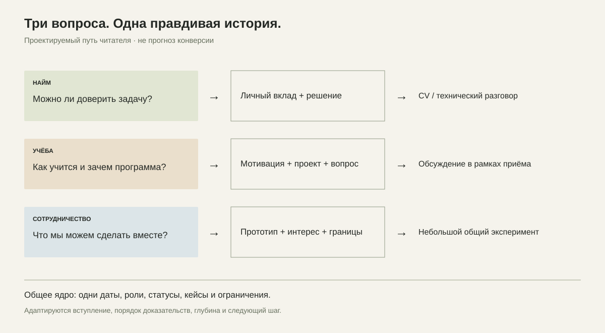
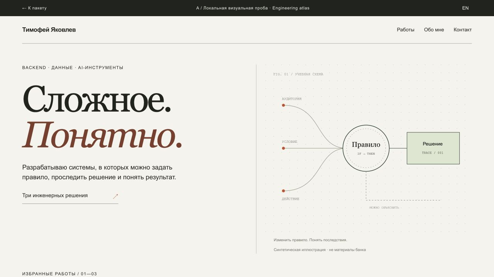
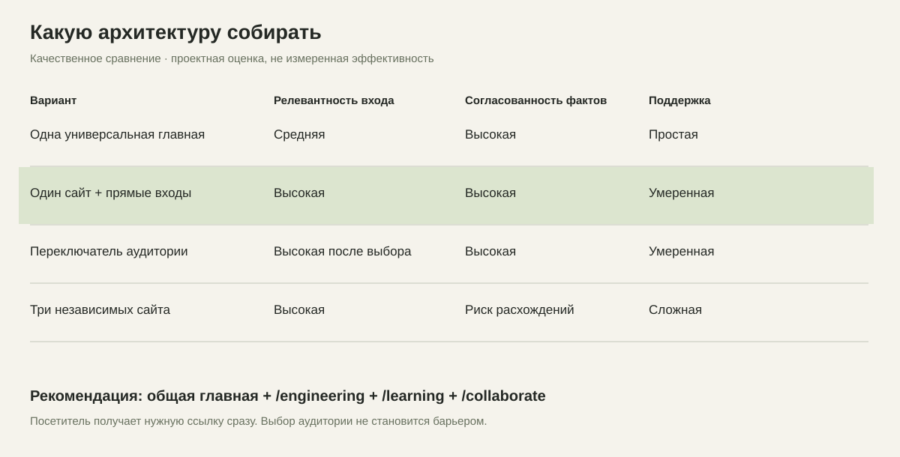
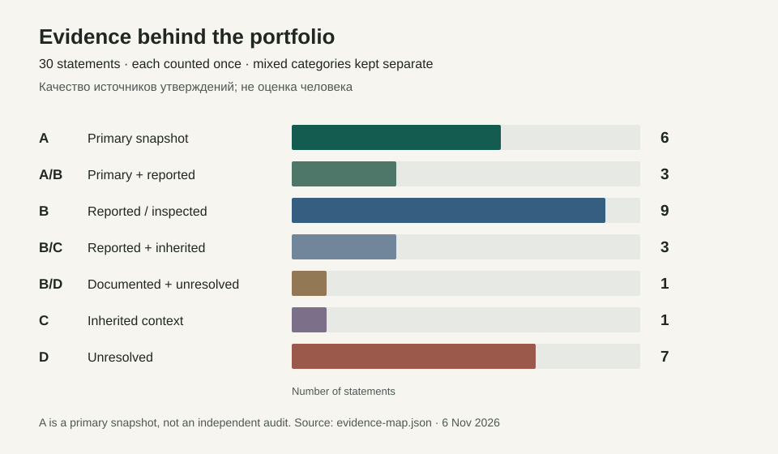

# Timofei Iakovlev — portfolio research

**Исследование личного сайта, карьерная упаковка RU/EN и три проверяемые визуальные концепции.**

Сайт должен помогать человеку принять следующее решение: пригласить на инженерный разговор, обсудить учебную мотивацию или начать совместный проект. Этот репозиторий сохраняет аргументы, источники, тексты и пробы — не только готовую картинку.

**English:** an evidence-led portfolio study for engineering work, university applications and collaboration. Career copy and case studies are available in Russian and English. Research is primarily in Russian. This is a review-stage content and design package, not a deployed website or a claim that all biographical details have been verified.

## Начать здесь

1. [Зачем сайт и для кого](research/audience-strategy.md) — три равноправные аудитории, четыре архитектуры, одна рекомендация.
2. [Реальные результаты публичной работы](research/documented-outcomes.md) — Evans, Robinson, Simon и Harris; что доказано, а что нет.
3. [Три визуальных направления](design/README.md) — живые HTML-пробы, скриншоты и принципы оформления.
4. [Кейсы RU](content/cases-ru.md) / [EN](content/cases-en.md) — T-Bank, CODY, BPMN.space.
5. [Карьерные материалы и тексты](content/README.md), [CV RU](cv/Timofei_Iakovlev_CV_RU.pdf), [CV EN](cv/Timofei_Iakovlev_CV_EN.pdf).

## Главное решение

Один сайт с общими фактами и кейсами. Короткая главная плюс прямые маршруты `/engineering`, `/learning`, `/collaborate`. Язык переключается RU/EN; биография остаётся одной.



**Рекомендуемый визуальный каркас — A / Инженерный атлас.** В кейсах — одна демонстрация из B. В учебной истории — открытые вопросы и личный голос из C. Не нужно три сайта и не нужно складывать все эффекты на главную.



## Что есть в репозитории

| Каталог | Содержание |
|---|---|
| `research/` | Аудитории, источники, документированные исходы, реестр утверждений, схема архитектуры, платный оффер |
| `content/` | Главная и адресные страницы RU/EN, кейсы, LinkedIn, план GitHub |
| `cv/` | Master и краткие версии RU/EN, два одностраничных PDF |
| `design/` | Арт-дирекция и сравнение трёх содержательных концепций |
| `concepts/` | Автономные двуязычные HTML-пробы с локальными взаимодействиями |
| `previews/` | Проверенные изображения первых экранов |

## Аналитика без выдуманной точности



Сравнение качественное. Нет данных о конверсии будущего сайта, поэтому нет придуманных процентов успеха. [Карта подтверждения утверждений](research/evidence-method.md) показывает качество источников, а не оценку способностей автора.



## Статусы и факты

- T-Bank — командный профессиональный опыт; кейс описывает личные задачи, не авторство всей платформы.
- CODY — личный рабочий прототип по проектным материалам; end-to-end проверка текущей сборки не выполнялась в этом исследовании.
- BPMN.space — командный хакатонный прототип; точное разделение работы между участниками ещё уточняется.
- Даты найма и текущий HR title требуют сверки. В CV указан период описанной работы, без выдуманной непрерывной хронологии.
- Дипломы достижений и языковые сертификаты не проверены. B1 — самооценка, IELTS/C1 не заявлены полученными.

Подробности: [редакторские примечания к CV](research/cv-editorial-notes.md), [проверка кейсов](research/case-verification.md).

## Как посмотреть визуальные пробы

Скачайте репозиторий и откройте `index.html` или любой файл в `concepts/`. Всё работает локально, внешние ключи и сборка не нужны. GitHub показывает исходный HTML; GitHub Pages в этой работе не включался.

При желании запустите локальный сервер из каталога репозитория:

```sh
python3 -m http.server 8000
```

Откройте `http://localhost:8000`. В B проверяются два состояния: неизвестный согласующий и назначенная роль. В C переключаются главы. Во всех трёх пробах есть RU/EN.

## Что дальше

1. Сверить биографические поля и личный вклад в командных проектах.
2. Выбрать направление и проверить понятность на представителях трёх аудиторий.
3. Записать один актуальный сквозной сценарий CODY и подготовить разрешённый публичный код/демо.
4. Собрать production-сайт и только затем решать о его публикации.
5. Проверять спрос через [один ограниченный платный пилот](research/client-offer.md).

## Границы публикации

В репозитории нет исходного архива работодателя, внутренних URL и идентификаторов, клиентских записей, секретов или закрытого кода CODY/BPMN.space. Публичная карта источников содержит обобщения; частные оригиналы не прилагаются. Синтетические иллюстрации не являются банковскими интерфейсами или измерениями работающего продукта.

Исследование и тексты подготовлены с AI-помощью и требуют авторского финального просмотра. Полезные выводы из референсов отделены от доказательств результата. Ни один материал не обещает найм, поступление или доход. [Полный список источников](research/sources.md).

Обновлено 6 ноября 2026. Контакт: [GitHub TimofeyYA1](https://github.com/TimofeyYA1).
