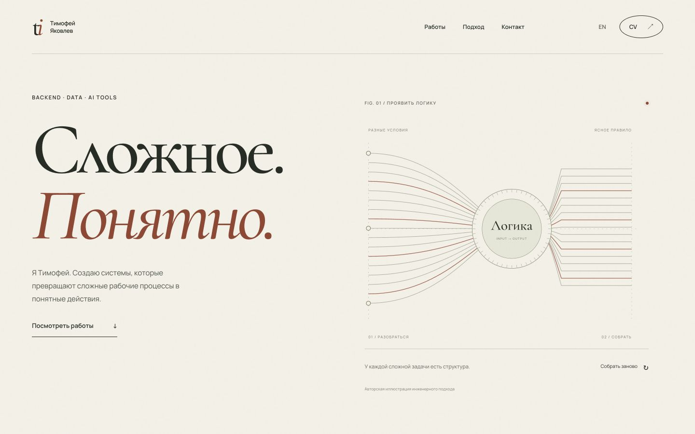

# Timofei Iakovlev — portfolio research

**Работающий личный сайт RU/EN, интерактивные кейсы, три аудитории и исследование решений.**

Сайт должен помогать человеку принять следующее решение: пригласить на инженерный разговор, обсудить учебную мотивацию или начать совместный проект. Этот репозиторий сохраняет аргументы, источники, тексты и пробы — не только готовую картинку.

**English:** an evidence-led portfolio study for engineering work, university applications and collaboration. Career copy and case studies are available in Russian and English. Research is primarily in Russian. The repository now includes the complete static site, three interactive case illustrations and three audience routes. The hosted site is owner-private; this source/research repository is public. Biographical caveats remain documented.

## Посмотреть сайт

**[Открыть размещённый сайт](https://timofei-iakovlev-work.bracedcliff.chatgpt.site)** — доступ владельцу через его аккаунт ChatGPT. Это рабочая версия с отдельными страницами, анимацией и локальными интерактивными моделями. Публичный доступ к размещённому сайту пока не включён.



В репозитории находится весь [исходный сайт](site/README.md). Его можно запустить самостоятельно:

```sh
python3 -m http.server 8000 --directory site/dist
```

Открыть `http://localhost:8000/ru/` или `/en/`. Затем доступны `engineering/`, `learning/`, `collaborate/` и `work/tbank/`, `work/cody/`, `work/bpmn/`. Для обновления текстов: `python3 site/build.py`.

Внутри: правила экспериментов с проверкой ошибки, иллюстрация контекста CODY, построение процесса после уточнения, CV RU/EN, нативная прокрутка и поддержка reduced motion. [Проверки и ограничения](site/VALIDATION.md), [open-source компоненты и лицензии](site/CREDITS.md), [исследование анимации](research/site-motion-research.md).

## Начать здесь

1. [Зачем сайт и для кого](research/audience-strategy.md) — три равноправные аудитории, четыре архитектуры, одна рекомендация.
2. [Реальные результаты публичной работы](research/documented-outcomes.md) — Evans, Robinson, Simon и Harris; что доказано, а что нет.
3. [Три визуальных направления](design/README.md) — живые HTML-пробы, скриншоты и принципы оформления.
4. [Кейсы RU](content/cases-ru.md) / [EN](content/cases-en.md) — T-Bank, CODY, BPMN.space.
5. [Карьерные материалы и тексты](content/README.md), [CV RU](cv/Timofei_Iakovlev_CV_RU.pdf), [CV EN](cv/Timofei_Iakovlev_CV_EN.pdf).

## Главное решение

Один сайт с общими фактами и кейсами. Короткая главная плюс прямые маршруты `/engineering`, `/learning`, `/collaborate`. Язык переключается RU/EN; биография остаётся одной.


**В реализованном сайте принят каркас A / Инженерный атлас.** В кейсах — одна демонстрация из B. В учебной истории — открытые вопросы и личный голос из C. Не нужно три сайта и не нужно складывать все эффекты на главную.

Первоначальные пробы сохранены для сравнения с итоговым сайтом.

## Что есть в репозитории

| Каталог | Содержание |
|---|---|
| `site/` | Полный сайт: 15 HTML-страниц, три демо, тексты, шрифты, лицензии и инструкция |
| `research/` | Аудитории, источники, документированные исходы, реестр утверждений, схема архитектуры, платный оффер |
| `content/` | Главная и адресные страницы RU/EN, кейсы, LinkedIn, план GitHub |
| `cv/` | Master и краткие версии RU/EN, два одностраничных PDF |
| `design/` | Арт-дирекция и сравнение трёх содержательных концепций |
| `concepts/` | Автономные двуязычные HTML-пробы с локальными взаимодействиями |
| `previews/` | Проверенные изображения первых экранов |

## Аналитика без выдуманной точности


Сравнение качественное. Нет данных о конверсии будущего сайта, поэтому нет придуманных процентов успеха. [Карта подтверждения утверждений](research/evidence-method.md) показывает качество источников, а не оценку способностей автора.


## Статусы и факты

- T-Bank — командный профессиональный опыт; кейс описывает личные задачи, не авторство всей платформы.
- CODY — личный рабочий прототип по проектным материалам; end-to-end проверка текущей сборки не выполнялась в этом исследовании.
- BPMN.space — командный хакатонный прототип; точное разделение работы между участниками ещё уточняется.
- Даты найма и текущий HR title требуют сверки. В CV указан период описанной работы, без выдуманной непрерывной хронологии.
- Дипломы достижений и языковые сертификаты не проверены. B1 — самооценка, IELTS/C1 не заявлены полученными.

Подробности: [редакторские примечания к CV](research/cv-editorial-notes.md), [проверка кейсов](research/case-verification.md).

## Как посмотреть визуальные пробы

Скачайте репозиторий и откройте `index.html` или любой файл в `concepts/`. Всё работает локально, внешние ключи и сборка не нужны. GitHub показывает исходный HTML; GitHub Pages в этой работе не включался.

При желании запустите локальный сервер из каталога репозитория:

```sh
python3 -m http.server 8000
```

Откройте `http://localhost:8000`. В B проверяются два состояния: неизвестный согласующий и назначенная роль. В C переключаются главы. Во всех трёх пробах есть RU/EN.

## Что дальше

1. Сверить биографические поля и личный вклад в командных проектах.
2. Проверить понятность готового сайта на представителях трёх аудиторий.
3. Записать один актуальный сквозной сценарий CODY и подготовить разрешённый публичный код/демо.
4. После авторского просмотра определить публичный доступ и постоянный домен сайта.
5. Проверять спрос через [один ограниченный платный пилот](research/client-offer.md).

## Границы публикации

В репозитории нет исходного архива работодателя, внутренних URL и идентификаторов, клиентских записей, секретов или закрытого кода CODY/BPMN.space. Публичная карта источников содержит обобщения; частные оригиналы не прилагаются. Синтетические иллюстрации не являются банковскими интерфейсами или измерениями работающего продукта.

Исследование и тексты подготовлены с AI-помощью и требуют авторского финального просмотра. Полезные выводы из референсов отделены от доказательств результата. Ни один материал не обещает найм, поступление или доход. [Полный список источников](research/sources.md).

Обновлено 6 ноября 2026. Контакт: [GitHub TimofeyYA1](https://github.com/TimofeyYA1).
