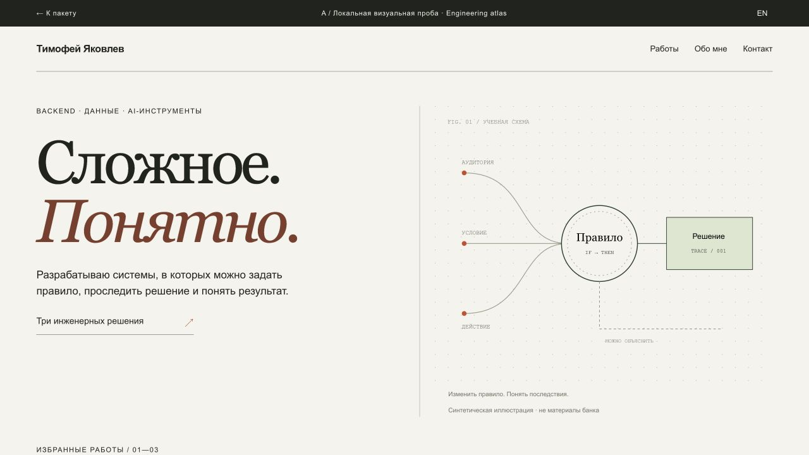
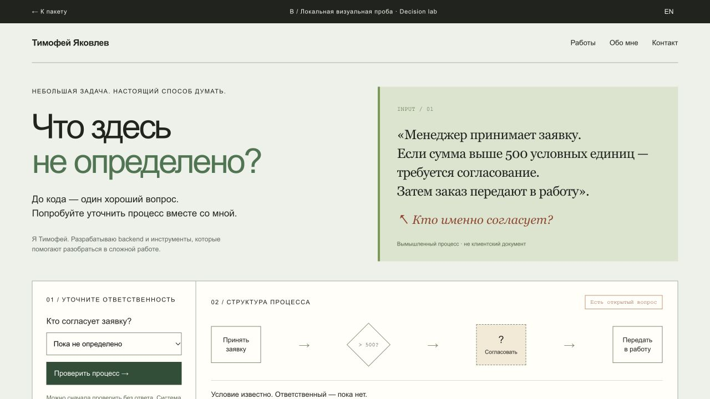
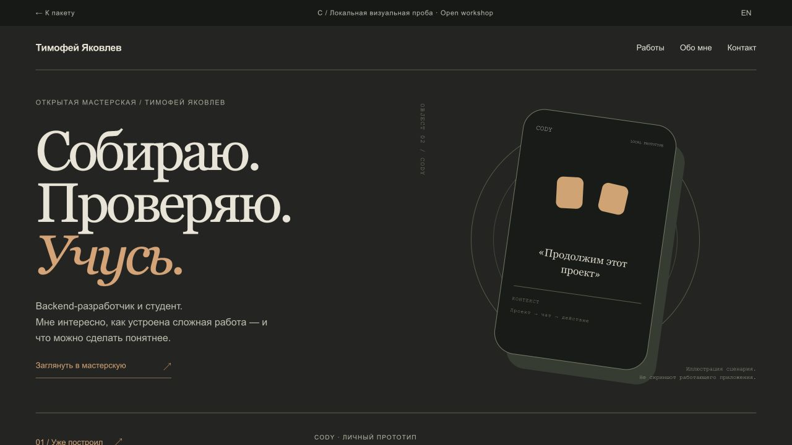

# Три направления личного сайта

Три визуальные пробы реализованы как самостоятельные HTML-файлы, RU/EN, без зависимостей и внешних запросов. Это исследования подачи, не production-сайт. Их можно скачать и открыть локально; GitHub показывает HTML как исходный код.

## Рекомендация

**A — общий каркас. B — один демонстрационный фрагмент внутри кейса. C — характер страницы об учёбе и рассказа о CODY.** Не соединять три первых экрана в одну перегруженную главную.

| Направление | Найм | Университет | Сотрудничество | Цена поддержки |
|---|---|---|---|---|
| A / Инженерный атлас | Быстрый переход к решению и роли | Проекты + объяснение обучения | Понятный подход к задаче | Низкая–средняя |
| B / Лаборатория решений | Хороший второй слой | Видимый переход к формальной модели | Совместное уточнение задачи | Средняя–высокая |
| C / Открытая мастерская | Личная инициатива, нужен быстрый CV | Мотивация и открытые вопросы | Интересы и совместимость | Регулярная редактура |

Оценка качественная, редакторская. Пользовательское исследование и конверсия не измерены.

## A / Инженерный атлас

[Открыть исходник пробы](../concepts/a-atlas.html)

Светлая бумага `#f5f3ec`, тёплый чёрный `#20231f`, красно-коричневый редакционный акцент `#7d3d2a`, спокойный зелёный в схемах. Georgia + Arial, ширина набора около 1200 px, поля 4.5%, тонкая сетка и крупный масштаб шрифта. На телефоне колонки складываются; к основному тезису не добавляется карусель.

Смысл: три решения вместо галереи технологий. Ведущий кейс — конфигурации экспериментов. Схема создана заново, не раскрывает архитектуру банка. Следующий экран — индекс трёх кейсов с различёнными статусами.

Референсные приёмы: [Paco Coursey](https://paco.me/) — спокойная структура и конкретные переходы; [Mitchell Hashimoto](https://mitchellh.com/) — роли и честные статусы; [Rauno Freiberg](https://rauno.me/) — масштаб типографики. Референсы задают приём, не копию композиции или чужой биографии.

## B / Лаборатория решений

[Открыть исходник пробы](../concepts/b-lab.html)

Фон `#edf1e9`, исходная заметка на `#dbe3cd`, действие `#294e36`, отдельная тёплая ошибка. Контрастная типографика, читаемый фрагмент требования, локальная проверка и результат рядом.

Сценарий: в заметке есть условие согласования, но отсутствует ответственный. Проверка без ответа показывает ошибку. Выбор роли обновляет схему и явно помечает источник как уточнение пользователя. Смена ответа делает результат требующим повторной проверки. Нет AI-запросов и сбора документов посетителя. Это самостоятельная иллюстрация принципа, не запущенный BPMN.space и не экспорт полноценной BPMN 2.0.

Референсный принцип: [Bartosz Ciechanowski](https://ciechanow.ski/) — менять параметр и понимать последствие. [Julia Evans](https://jvns.ca/projects/) — небольшие инструменты, объясняющие конкретную задачу. Ограничение: упражнение не должно закрывать доступ к CV и контакту.

## C / Открытая мастерская

[Открыть исходник пробы](../concepts/c-workshop.html)

Тёмный `#242522`, светлый `#e9e4d7`, тёплый акцент `#dda070`. Один крупный предмет — иллюстрация CODY; без выдуманной фотографии автора и без имитации записи работающего приложения. Три переключаемые главы: уже построил, исследую, хочу научиться.

Смысл: человек виден через вопросы и работу. Основа для /learning и /collaborate. Референсы: [Maggie Appleton](https://maggieappleton.com/) — уровни зрелости мыслей; [Derek Sivers](https://sive.rs/) — глубина знакомства по желанию читателя. [Bruno Simon](https://bruno-simon.com/) — демонстрация своей способности самим портфолио; игровой обязательный вход здесь не копируется.

## Условия следующей реализации

- Текст, CV и контакт доступны без игры, видео и регистрации.
- Клавиатура, видимый фокус, подписи состояний и reduced motion.
- На широком экране один главный тезис; на телефоне сначала смысл и действие, затем иллюстрация.
- Нет поддельных отзывов, метрик, счётчиков пользователей или логотипов клиентов.
- Тяжёлое видео — после действия зрителя, с субтитрами и текстовым сценарием.
- Плановый бюджет: статическая первая загрузка без видео до 500 KB; это цель для production, не измерение этих исследовательских файлов.
- Проверка на 6 людях из трёх аудиторий: найти роль, статус проекта и следующий шаг. Результаты теста пока не получены.

## Проверка проб

Ручная проверка выполнялась в браузере: первый экран, RU/EN, сценарий ошибки и успеха B, переключение глав C. Desktop и mobile снимки находятся в previews. Все изображения — созданные для этих материалов схемы и иллюстрации; банковские и клиентские экраны не использовались.
