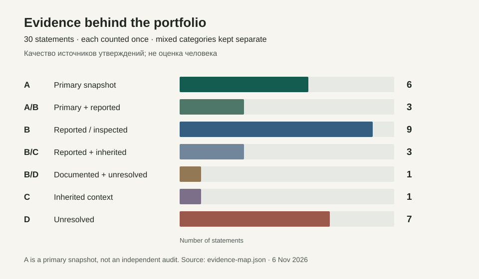

# How portfolio claims were checked

This portfolio uses a claim register to separate personal contribution, project output and evidence quality. The public map contains 30 bounded records. Private documents, source code, account details and employer-specific identifiers are excluded. Opaque labels such as `E03` connect to the owner's private verification register; they do not make the underlying sources publicly auditable.

| Label | Meaning | Records |
|---|---|---:|
| A | Archived primary project records. A snapshot is not an independent audit or current production verification. | 6 |
| A/B | Primary records combined with self-report or derived documentation. | 3 |
| B | Self-report, project documentation or targeted code inspection. Code presence is not proof of runtime readiness. | 9 |
| B/C | Documented or self-reported material combined with inherited research. | 3 |
| B/D | A project is documented, but attribution, outcome or public scope remains unresolved. | 1 |
| C | Inherited context or a previous summary that has not been independently substantiated here. | 1 |
| D | Conflicting, unsupported or unresolved claims. This can concern dates, completion, measurement or attribution. | 7 |

The categories describe sources for statements, not the person's ability. Mixed labels are counted separately; each record appears once. These 30 records are not 30 completed projects. The counts are derived from the `confidence` values in [evidence-map.json](evidence-map.json).

## Editorial rules

- Name the individual's contribution separately from the team's result.
- Distinguish implemented code, a working prototype, a concept and verified use in production.
- Keep project dates separate from hiring dates. Do not turn an unresolved role into an inflated title.
- Use a measured outcome only when the method, baseline and meaning are known. Activity counts and changed test files do not establish test coverage or business impact.
- Prefer a limited, concrete result over an unsupported superlative. Keep unfinished work out of completed achievements.
- Use synthetic illustrations for private systems. An illustration is not a live demonstration or a screenshot of the original product.

## Current verification limits

The register includes archived records, owner-provided career materials and selected code/documentation checks. It does not include a live employer audit, a complete code audit, end-to-end testing of every prototype, independently verified business metrics or examination of every qualification. Publication of this methodology does not publish or grant access to the underlying private sources.

The current public revision incorporates a documentation/code discrepancy in CODY: an integration is not labelled either fully absent or production-ready. BPMN.space is supported by targeted code inspection, but individual ownership of every component remains unassigned. See [CV editorial notes](cv-editorial-notes.md) for the handling of career claims.
