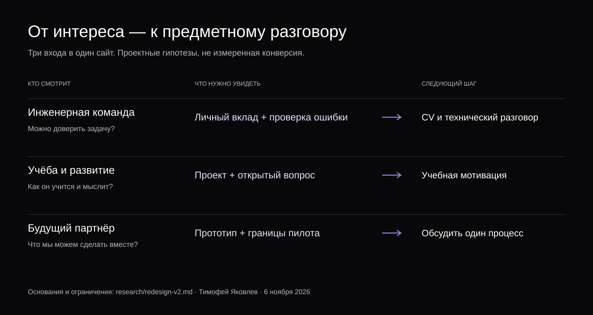

# Личный сайт: второй дизайн и основания решений

6 ноября 2026. Статус: реализованная новая версия; пользовательских измерений привлекательности и конверсии пока нет.

## Что было не так

Владелец прямо отверг первую визуальную версию. Кремовый фон, крупная антиква, абстрактный слоган и декоративная схема занимали первый экран, но слабо представляли конкретного человека. Это авторская оценка прежнего результата, а не результат A/B-теста. Ранние концепции сохранены как история поиска, а не как принятый финальный дизайн.

Новая версия заимствует выбранные владельцем принципы из [Continue style guide](https://continue-workspace-timofei.bracedcliff.chatgpt.site/style-guide.html): #08080A, белый, #7147EE, Manrope, непрерывный фон, движение связанных объектов при обычной прокрутке, неподвижный текст и приоритет reduced motion. Авторство человека раскрывается через проекты и решения. Логотип Continue не используется.

## Что может привлечь разные аудитории

| Читатель | Его вопрос | Что показать раньше | Следующий шаг |
| --- | --- | --- | --- |
| Инженерная команда | Что он делал сам и как принимает решения? | Конкретные задачи Т-Банка, личный вклад, проверка ошибки, границы прототипов | CV и технический разговор |
| Преподаватель / учебная программа | Как он учится и какие вопросы задаёт? | Проект → неизвестное → уточнение → следующий предмет изучения | Обсудить учебную мотивацию |
| Будущий партнёр | Можно ли вместе сделать полезную вещь? | CODY/BPMN, понятная задача, узкий первый пилот | Описать процесс и согласовать критерии |

Это проектные гипотезы для текущего человека. Они не описывают всех нанимающих менеджеров, вузов или клиентов. Главная даёт общее знакомство, адресные страницы меняют порядок доказательств, а факты остаются общими.

## Что говорят источники — и что мы из этого вывели

**Портфолио и найм.** [Исследование NN/g](https://www.nngroup.com/articles/ux-design-portfolios/) опирается на 204 человека, участвующих в найме UX-специалистов. Для этой аудитории важны ход решения, роль кандидата, контекст и итог. Перенос на backend — наша интерпретация, не прямой вывод исследования. В сайте она выражена в ясном личном вкладе и примере проверки перед длинным текстом.

**Курация разработческих работ.** [Josh Comeau](https://www.joshwcomeau.com/effective-portfolio/) описывает опыт просмотра нескольких сотен портфолио и предлагает небольшую подборку работ с содержательным объяснением. Его контекст — прежде всего начинающие frontend-разработчики, а не универсальный эксперимент о найме. Для Тимофея выбраны три разных проекта; каждый раскрывает конкретное решение, а не длинный список инструментов.

**Первое знакомство.** [Рекомендации NN/g по главной странице](https://www.nngroup.com/articles/113-design-guidelines-homepage-usability/) подчёркивают понятное назначение и доступность главных задач. Применение: настоящее имя и роль в первом экране, явный переход к работам, прямой CV и контакт. Это устойчивая практическая основа, а не новый «тренд 2026».

**Учебный маршрут.** [MIT Admissions о дополнительных портфолио](https://mitadmissions.org/apply/firstyear/portfolios-additional-material/) показывает ценность описания процесса создания и технической работы. Это пример конкретного институционального контекста, не заявленная цель поступления Тимофея и не обещание соответствия требованиям MIT. На учебной странице проекты связаны с открытыми вопросами, которые хочется изучать дальше.

**Видимая работа и успех.** [Ранее собранные документированные истории](documented-outcomes.md) разделяют четыре результата: авторские продажи Julia Evans, путь Lee Robinson, награду портфолио Bruno Simon и найм Rich Harris для работы над Svelte. Они не доказывают, что фиолетовый цвет или 3D повышают вероятность найма. Общее полезное действие — дать человеку посмотреть содержательную работу. Поэтому здесь есть проверяемые иллюстрации, а не вымышленные отзывы и ростовые графики.

## Что взяли из open source

[Видео пользователя](https://www.youtube.com/watch?v=Dp7HaDgtsEA) помогло найти направления: frontend-design, UI-компоненты, готовые стилевые системы, motion и отдельные мобильные подходы. Просмотрен доступный автоматический транскрипт; рекомендации ролика не считаются доказательством эффективности. Дословный транскрипт не публикуется.

Установлены [Anthropic Frontend Design](https://github.com/anthropics/skills/tree/main/skills/frontend-design) и [Impeccable](https://github.com/pbakaus/impeccable). Первый использован для новой композиции, второй — для финальной проверки уже собранной страницы. Это инструкции для работы, а не кнопка, гарантирующая хороший дизайн.

Из существующего runtime сохранены локальные Manrope и [Motion](https://motion.dev/). Для небольшого явного переключения состояния и движения двух плоскостей хватило Motion и native scroll. Добавление GSAP или Three.js само по себе не улучшило бы доказательства инженерного опыта. UI-компоненты shadcn полезны для приложений, но стандартный dashboard-каркас здесь не решает основную задачу знакомства.

## Принятые решения

| Решение | Зачем | Компромисс |
| --- | --- | --- |
| Имя и конкретная роль вместо общего слогана | Быстро понять, чей это сайт | Меньше места для абстрактного манифеста |
| Одна пространственная сцена CODY | Запомнить собственный проект и связь устройств | Сцена явно помечена иллюстрацией, не доказательством live-связи |
| Три маршрута возле знакомства | Дать разным посетителям подходящий вход | Добавляется один выбор, его можно пропустить |
| Пример перед подробным кейсом | Сначала увидеть принцип, потом читать аргументы | Демо синтетическое, реальный результат описан отдельно |
| Единый фон, крупная типографика, мало эффектов | Сохранить визуальную цельность и чтение | Отказ от одинаковой анимации появления каждого раздела |
| Native scroll и отдельный motion toggle | Сохранить контроль и доступность | Меньше театральных переходов и фиксации экрана |

Полная система: [DESIGN.md](../site/DESIGN.md). Протокол проверки: [VALIDATION.md](../site/VALIDATION.md). Данные об авторе: [реестр утверждений](evidence-method.md).

## Как проверить привлекательность на людях

Следующий исследовательский шаг — 3–5 коротких разговоров на каждую аудиторию, а не условный рейтинг «вау 9/10». Это предложенный план, ещё не выполненный.

1. Показать главную на 10–15 секунд. Спросить, кто этот человек, чем занимается и какой проект запомнился. Не подсказывать названия.
2. Дать задачу: найти личный вклад, открыть CV, объяснить ограничение прототипа или понять, какой пилот предложить.
3. Записать, где человек остановился, что понял неверно и какой вопрос хочет задать. Время выполнения — описательное наблюдение, не доказательство преимущества.
4. Сравнить две конкретные правки по одной переменной: порядок проектов либо формулировка вступления. При малой выборке использовать качественные наблюдения.
5. После реального публичного запуска считать содержательные обращения по аудиториям. Сейчас внешняя аналитика не подключена и процентов конверсии нет.

Успех сайта нельзя отделить от качества проектов, языка, контактов и соответствия аудитории. Дизайн создаёт понятный вход и делает работу запоминающейся; будущие результаты надо измерять отдельно.
